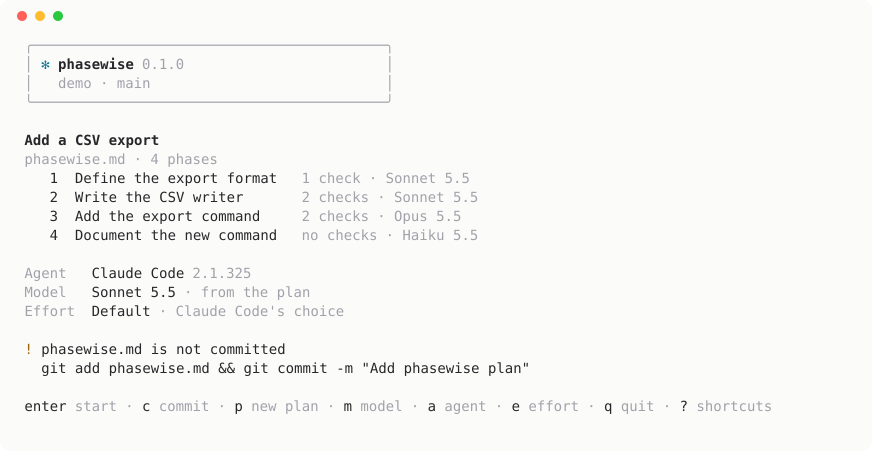
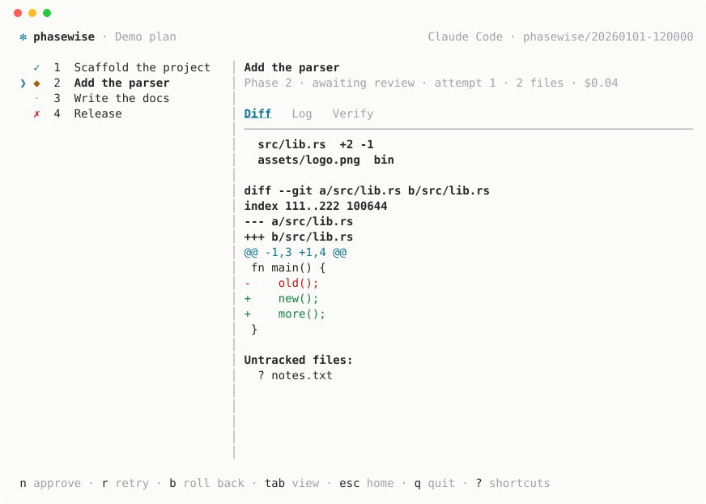

<div align="center">

# phasewise

**Run big plans with Claude Code or Codex one phase at a time:<br>verified by your checks, saved as git commits, reviewed by you.**

[](https://github.com/userfypp/phasewise/actions/workflows/ci.yml)
[](LICENSE)

</div>

<picture>
  <source media="(prefers-color-scheme: dark)" srcset="assets/readme/home-dark.svg">
  
</picture>

Hand a coding agent a big plan in one go and you get one huge change to review,
with no safe point to return to when step 7 breaks step 3. phasewise runs the
plan one phase at a time: the agent works on a single phase, your checks prove
it, a git commit saves it, and nothing continues until you have looked at it.

Your branch is never touched while a run is in progress. Every phase is a commit
you can inspect, retry with a note or roll back to. phasewise itself never
pushes and makes no network connections.

### How it works

| | |
|---|---|
| **1. Plan** | Describe the goal in one sentence. The agent reads your project, without changing it, and writes `phasewise.md`. Or write the plan yourself. |
| **2. Run** | Each phase runs headless on the branch `phasewise/<run-id>`, then your checks run. A failure goes back to the agent with the output. |
| **3. Review** | Read the diff, the agent's log and the checks. Approve the phase, retry it with a note, or roll back. |
| **4. Merge** | When the last phase is approved, merge the run branch into yours. |

<picture>
  <source media="(prefers-color-scheme: dark)" srcset="assets/readme/run-dark.svg">
  
</picture>

### Quick start

You need git, macOS or Linux, [Rust](https://rustup.rs) 1.88 or later, and
[Claude Code](https://code.claude.com/docs) or
[Codex](https://github.com/openai/codex) installed and logged in.

```sh
cargo install --path .      # from a clone of this repository
cd your-project
phasewise                   # opens the home screen
```

Press `p` and describe what you want. Read the plan the agent writes, press `c`
to commit it and `enter` to start. Every step is also a command:
`phasewise plan "…"`, `phasewise run`, `phasewise next`.

The [user guide](docs/user-guide.md) covers the screens, plans, models, every
command and what to do when a phase fails.

### Good to know

- The agent works without permission prompts, as your user and with your
  environment. The run branch protects your history, not your machine: read
  [Security](SECURITY.md) before running a plan you did not write.
- Agents cost money. phasewise shows Claude Code's cost per phase; Codex does
  not report one.
- Tested with Claude Code 2.1.325 and Codex CLI 0.160.0. Agent CLIs change
  often: [Agents](docs/agents.md) lists the exact command lines phasewise uses.
- Windows is not supported.

### Documentation

[User guide](docs/user-guide.md) · [Plan format](docs/plan-format.md) ·
[Agents](docs/agents.md) · [Architecture](docs/ARCHITECTURE.md) ·
[Decisions](docs/decisions.md) · [Roadmap](docs/ROADMAP.md) ·
[Changelog](CHANGELOG.md) · [Contributing](CONTRIBUTING.md) ·
[Security](SECURITY.md) · [Code of conduct](CODE_OF_CONDUCT.md)

<sub>MIT licensed. © userfypp.</sub>
